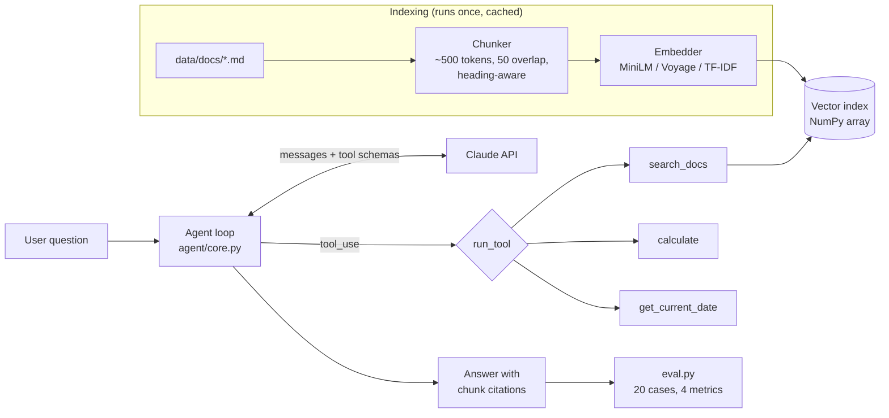

# docs-qa-agent

A small agent that answers questions about a set of documents, with retrieval, tool calling and an eval suite. The documents are a fictional employee handbook for "Acme Robotics": 25 markdown files covering PTO, benefits, expenses, travel, security, on-call and more. Swap in your own docs by replacing `data/docs/`.

Example session (illustrative; your tool calls and wording will vary):

```
$ python chat.py "What's the most I can expense for 4 nights at a hotel in San Francisco?"
  -> search_docs({'query': 'hotel nightly cap San Francisco'})
     [travel-booking#0] (from: Travel Booking Policy, similarity 0.61) ...
  -> calculate({'expression': '350 * 4'})
     1400
Hotels in San Francisco are capped at $350 per night [travel-booking#0], so 4 nights
comes to at most $1,400 before taxes.
```

## Architecture



- **Retrieval** (`agent/retrieval.py`): docs are split into ~500-token chunks made of whole sentences, with a 50-token overlap. A heading never ends a chunk. Chunks are embedded once, stored as a normalized NumPy matrix, and cached in `data/index/`. Search is a single matrix-vector product (cosine similarity) returning the top 4. There's no vector DB; at this size one isn't needed.
- **Embedders**, set with `--embedder` or `RAG_EMBEDDER`:
  - `local` (default): `all-MiniLM-L6-v2` via sentence-transformers. Free, runs on CPU, downloads ~90 MB once.
  - `voyage`: Voyage AI API (`voyage-4-lite`). Needs `VOYAGE_API_KEY`.
  - `tfidf`: sparse vectors built from the corpus, with no download and no key. Used for tests and CI.
- **Agent** (`agent/core.py`): a hand-written tool-use loop over the Anthropic Messages API. It calls the model, runs every `tool_use` block, returns `tool_result`s and repeats until the model answers, up to 8 turns. The system prompt requires a `search_docs` call before answering, `[chunk-id]` citations, `calculate` for all arithmetic, and "I don't know" when the docs don't cover the question. Each run records its full trace: tool calls, retrieved chunk IDs, citations, tokens and latency.
- **Tools** (`agent/tools.py`): `search_docs`, `calculate` (parses an arithmetic AST, never `eval`s), and `get_current_date`.

## Setup

macOS / Linux:

```bash
python -m venv .venv && source .venv/bin/activate
pip install -r requirements.txt
export ANTHROPIC_API_KEY=sk-ant-...
python chat.py                    # interactive; or pass a question as an argument
```

Windows (PowerShell):

```powershell
python -m venv .venv; .venv\Scripts\Activate.ps1
pip install -r requirements.txt
$env:ANTHROPIC_API_KEY="sk-ant-..."
python chat.py
```

Optional environment variables: `AGENT_MODEL` (default `claude-sonnet-5-5`), `RAG_EMBEDDER`, `RAG_CHUNK_SIZE`, `RAG_OVERLAP`.

## Evaluation

`evals/cases.jsonl` has 20 cases: 8 lookups, 4 arithmetic, 3 multi-hop, 1 that needs today's date, and 4 the handbook cannot answer. Each case lists expected facts, the evidence phrase that must be retrieved, and the expected tools.

```bash
python eval.py --retrieval-only        # retrieval only, no Claude calls
python eval.py --label baseline        # full agent run -> results/baseline.{json,md}
python eval.py --judge                 # + LLM-as-judge score
python eval.py --compare before after  # before/after table from two saved runs
python sweep.py                        # chunk size x overlap grid
python -m pytest tests                 # offline unit tests
```

| metric | what it checks |
|---|---|
| `retrieval_hit` | every evidence phrase is inside the top-4 chunks (hit@4) |
| `hit_at_1`, `mrr` | rank-sensitive retrieval scores (retrieval-only mode) |
| `tool_choice` | the agent called every expected tool |
| `answer_correct` | every expected fact is in the answer (string match, `a\|b` = either) and no forbidden string is |
| `refusal` | on unanswerable questions, it said "I don't know" and invented nothing |
| `false_refusal` | on answerable questions, it wrongly said "I don't know" (lower is better) |
| `citations_valid` | every cited `[chunk-id]` was actually returned by `search_docs` |
| `judge` | optional: an LLM grades the answer 1–5 against the evidence, rescaled to 0–1 |

Retrieval hits are checked by evidence phrase, not by chunk ID, so the same cases keep working when chunk size changes.

### Results

**Agent:** *(run `python eval.py --label agent-baseline`, then paste the table from `results/agent-baseline.md` here)*

**Retrieval** (16 answerable cases, top 4, TF-IDF embedder; `results/sweep-tfidf.md`):

| chunk size | overlap | heading-aware | chunks | hit@4 | hit@1 | MRR |
|---|---|---|---|---|---|---|
| 500 | 0 | no | 28 | 0.94 | 0.81 | 0.88 |
| **500** | **0** | **yes** | 28 | 0.94 | **0.88** | **0.91** |
| 500 | 50 | yes | 28 | 0.94 | 0.88 | 0.91 |
| 300 | 50 | yes | 32 | 0.94 | 0.88 | 0.91 |
| 150 | 0 | yes | 58 | 0.94 | 0.56 | 0.74 |
| 150 | 50 | yes | 65 | 0.94 | 0.81 | 0.85 |
| 100 | 50 | yes | 120 | 0.94 | 0.62 | 0.74 |

### The one change: heading-aware chunking

**Before** (`results/before.md`): the chunker cut wherever the token budget ran out, so a chunk could end on a section heading with its text in the next chunk. In `pto-policy`, chunk 0 ended with the heading `## Payout when you leave`, and chunk 1 was a single orphaned sentence: "Accrued but unused PTO is paid out in your final paycheck…". For "Can I roll unused vacation days over into next year?", that tiny chunk ranked first. It shares "unused" and "PTO" with the query and has almost nothing else to dilute its cosine score. The real answer, in chunk 0, came second.

**After** (`results/after.md`): a heading that would end a chunk moves to the start of the next one. The orphan chunk now carries its heading, "Payout when you leave", so it reads as a separate topic, and the carryover section ranks first. It only wins by a hair, though (cosine 0.152 vs 0.150).

| metric | before | after | change |
|---|---|---|---|
| hit@4 | 0.94 | 0.94 | +0.00 |
| hit@1 | 0.81 | 0.88 | +0.06 |
| MRR | 0.88 | 0.91 | +0.03 |

The fix moved `pto-carryover` from rank 2 to rank 1. That is one case out of 16, so it's a modest result. The broader lesson is that very short chunks are a retrieval hazard: they win cosine matches on a couple of shared words. With 16 cases, one case is about 6 points, and any difference that small should be read as a direction, not a precise number.

What the sweep showed along the way:

1. **hit@4 was saturated.** Every configuration scored 0.94, because with 28 chunks the top 4 cover a seventh of the corpus. I added hit@1 and MRR so changes would show up at all.
2. **Smaller chunks hurt.** 150-token chunks with no overlap dropped hit@1 to 0.56. Multi-fact answers got split across chunks, and for the SEV1 status-page question, the "Declaring an incident" chunk outranked the severity-levels chunk that holds the answer. A 50-token overlap recovered most of the loss (0.56 → 0.81).
3. **The heading fix and overlap solve the same problem**: context lost at chunk boundaries. Once there's a 50-token overlap, the heading fix changes nothing.
4. **The remaining miss is a vocabulary problem.** "Work from Portugal for three weeks" shares no words with "work from another country for up to 30 days". Sparse vectors can't bridge that; dense embeddings should. Check with `python sweep.py --embedder local`.

## What I'd improve

- **Re-run retrieval with dense embeddings** (`--embedder local` or `voyage`). The table above uses TF-IDF, and the `work-abroad` miss is the case to watch.
- **A bigger, harder eval set.** 20 cases is too few to separate configurations; aim for 100+, with more paraphrased questions and more near-miss unanswerables (questions that sound covered but aren't).
- **Hybrid search**: BM25 plus dense vectors, merged with reciprocal-rank fusion, then a reranker on the top 20.
- **Grade citations more strictly.** Today a citation only has to be a chunk that was retrieved; it should also contain the fact it's attached to.
- **Run each case several times.** Model output varies between runs; report the mean and spread over 3–5 runs before calling a change an improvement.
- **Track cost alongside quality.** Tokens and latency are already recorded per case; compare models (e.g. Haiku vs Sonnet) on score per dollar.

## Layout

```
agent/
  retrieval.py   chunking, embedders, NumPy vector index
  tools.py       tool schemas + implementations
  core.py        agent loop, system prompt, run trace
data/docs/       25 handbook documents (the corpus)
evals/cases.jsonl  20 eval cases
eval.py          scoring, reports, before/after comparison
sweep.py         retrieval parameter grid
results/         saved eval runs
tests/           offline tests with a scripted fake client
chat.py          CLI
```
